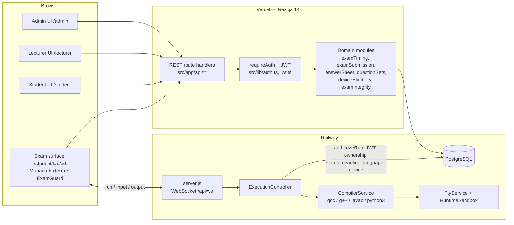
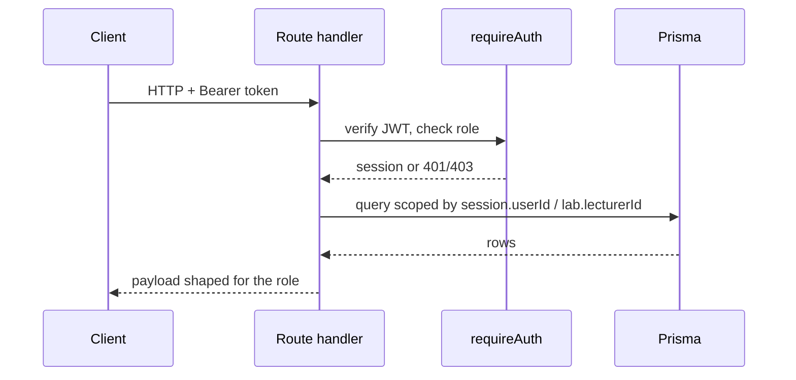
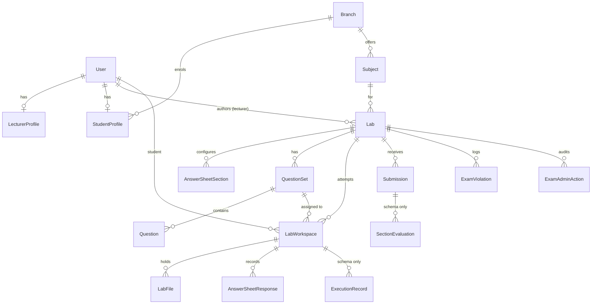
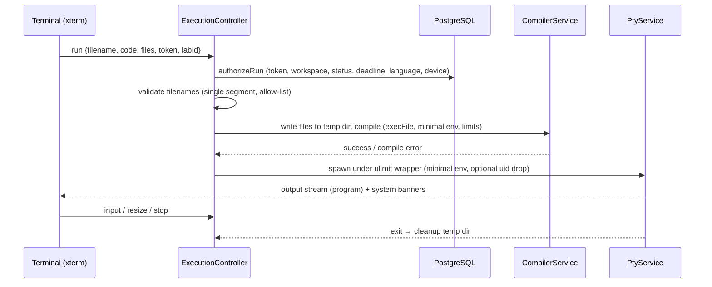

# SYSTEM_ARCHITECTURE.md — LabSubmit

Reconstructed from the code at commit `85240d1` (2026-11-08). `/CLAUDE.md` §8 holds the
short architecture map; this document expands it.

## 1. High-level architecture

Both hosts read the same database and must share a byte-identical `JWT_SECRET`.

## 2. Frontend

- **Routes:** `/` (landing), `/login`, `/register`, `/student`, `/student/lab/[id]`,
  `/lecturer`, `/admin`. Each role dashboard is one route with tabbed sections.
- **Shell:** `AppShell` (sidebar ≥ `lg`, drawer below) with `STUDENT_NAV` / `LECTURER_NAV` /
  `ADMIN_NAV`. The exam surface deliberately does **not** use the shell.
- **State:** `AppContext` holds the user, token and theme. Pages fetch with `fetch` +
  `Authorization: Bearer`. No data-fetching library.
- **Design system:** `src/components/ui/index.tsx` primitives; tokens in `tailwind.config.js`.
- **Exam components:** `OnlineIDE` (files + Monaco), `Terminal` (xterm over WebSocket,
  captures runs for the answer sheet), `ExamGuard` (fullscreen/tab/devtools signals),
  `AnswerSheet` (renders the lecturer's configured sections), `QuestionPaper`.

## 3. Backend

- **Entry:** `server.js` → Next request handler; `upgrade` on `/api/ws` → `ExecutionController`
  (loaded through `tsx`).
- **REST:** Next route handlers, one file per resource; every non-public route calls
  `requireAuth(req, roles)`; lecturer routes additionally check `lab.lecturerId`.
- **Domain modules** (pure where shared with the client): exam status/deadline
  (`examTiming`), single idempotent `finalizeSubmission()` (`examSubmission`), section
  catalogue and validation (`answerSheet`), set assignment and student-paper shaping
  (`questionSets`), device policy (`deviceEligibility`).

## 4. Database

PostgreSQL via Prisma; 17 models. Core relations:

Full field-level documentation: `DATABASE_DOCUMENTATION.md` (pending — see roadmap).

## 5. Authentication & authorisation

- Login (`/api/auth/login`) checks bcrypt hash, issues HS256 JWT (7 days) carrying
  `userId`, `role`, `name`, `email`/`rollNumber`.
- Student self-registration is gated by admin-defined roll-number ranges.
- Token accepted from `Authorization: Bearer` or `token` cookie.
- Role enforcement is server-side in every route (`requireAuth`) and in the WebSocket
  (`authorizeRun`). Frontend navigation is convenience only.

## 6. Compiler / execution architecture

Limits: 15 s compile, 60 s wall-clock runtime, 5 MB output, CPU-seconds/file-size/memory
`ulimit`s (iteration 1). Isolation limits are documented in `SECURITY_AUDIT.md` S4.

## 7. Deployment

See `/DEPLOYMENT.md`. Vercel serves UI + REST (no `node-pty`); Railway runs the
`Dockerfile` image (`node:20-alpine` + build-base, python3, OpenJDK 17) for `server.js` and
hosts Postgres. Schema is applied with `prisma db push`.
