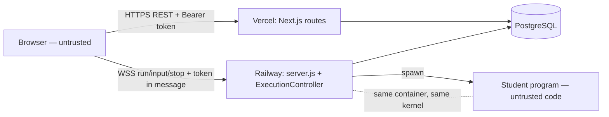

# THREAT_MODEL.md — LabSubmit

**Date:** 2026-11-08 · Scope: the code at `claude/labsubmit-development-y605fv`, the Vercel + Railway
deployment described in `DEPLOYMENT.md`, and the `Dockerfile`. Method: STRIDE per entry point,
grounded in the code paths named below. Findings are tracked in `SECURITY_AUDIT.md`.

## 1. Assets

| Asset | Where it lives | Why it matters |
|---|---|---|
| `JWT_SECRET` | Env on Vercel and Railway | Anyone holding it can mint a token for any user, including ADMIN |
| `DATABASE_URL` | Env on both hosts | Direct read/write of every record |
| Exam papers (problem statements, question sets) | `Lab.problemStatement`, `Question` | Early or cross-cohort disclosure voids the exam |
| Set assignment (who holds which set) | `LabWorkspace.questionSetId` | Lets students compare papers |
| Student work (code, answer sheet, run records) | `LabFile`, `AnswerSheetResponse`, `ExecutionRecord` | Integrity of the assessed work |
| Marks, remarks, publish state | `Submission`, `SectionEvaluation` | The result itself |
| Integrity log | `ExamViolation` | Evidence in disputes |
| Password hashes | `User.password` (bcrypt) | Credential compromise |
| Execution host | Railway container | Runs untrusted code next to the secrets above |

## 2. Actors

| Actor | Capability assumed |
|---|---|
| Anonymous internet user | Can reach every public URL and the WebSocket |
| Student (authenticated) | **Primary adversary.** Motivated (marks), technically capable, controls their browser fully, can script the API and WebSocket, can run arbitrary code on the execution host by design |
| Lecturer | Trusted for their own exams; must not reach other lecturers' exams or students outside them |
| Admin | Fully trusted for user management |
| Compromised dependency | Code running inside the app |

## 3. Entry points and trust boundaries

Boundaries, in order of risk:
1. **Student program ↔ execution host** (`PtyService`, `CompilerService`). The program is
   attacker-written code running on the host that holds both secrets. This is the boundary
   the whole platform's security rests on.
2. **Browser ↔ WebSocket** (`server.js`, `ExecutionController.authorizeRun`).
3. **Browser ↔ REST** (`requireAuth` in every route; ownership checks per route).
4. **REST ↔ database** (Prisma; no raw SQL anywhere — verified by grep).

Entry points: 28 REST route files (matrix in `API_SECURITY_MATRIX.md`), one WebSocket
endpoint (`/api/ws`), the static/page routes, and the Docker image build.

## 4. Threats (STRIDE) and status

| # | Threat | Entry / component | STRIDE | Status |
|---|---|---|---|---|
| T1 | Student program reads `JWT_SECRET` → forges ADMIN token | Execution host | E, I | Env scrub done (S1). **Verified on Linux:** `/proc/<server>/environ` readable without a uid (S4); blocked with `EXEC_RUN_UID_RANGE` — **open until deployed** |
| T2 | Student program writes outside its dir / injects shell | Compile path | T, E | Fixed (S2, S3) |
| T3 | Student program kills the server, fork-bombs, fills memory/disk | Execution host | D | Memory/disk/CPU limited (verified); server signalling and fork bombs blocked in pool mode (verified); not deployed |
| T4 | Student program reaches the network (DB, metadata, internet) | Execution host | I, E | **Open** — needs a sandbox (S4) |
| T5 | Forged / tampered / expired / `alg:none` tokens | `jwt.ts` | S | Mitigated (S5; HS256 pinned; tests) |
| T6 | Password guessing / account enumeration | `/api/auth/login` | S, I | Mitigated (S7) |
| T7 | Weak passwords chosen at registration or reset | password-setting routes | S | Fixed (S18) |
| T7b | Someone registers another student's roll number first | `register-student` | S | **Open** (S28, design) |
| T8 | Student reads exam paper early, across cohorts, or before starting their clock | `/api/student/workspace` | I | Fixed (S13) |
| T9 | Student reads other students' work / edits their files | workspace actions | I, T | Fixed (S12) |
| T10 | Student reads exam papers through faculty APIs | `/api/lecturer/*` | I, E | Fixed (S6); role matrix tested |
| T11 | Lecturer acts on another lecturer's exam | lecturer routes | E | Ownership checks verified; tested for evaluate/executions/labs |
| T12 | Student edits marks / results | evaluate route | T, E | Role-gated; tested |
| T13 | Storage exhaustion via huge files / answers | workspace actions | D | Fixed (S14) |
| T14 | WebSocket abuse: parallel runs, huge frames | `server.js` | D | Fixed (S15) |
| T15 | Orphaned processes outlive a run | `CleanupService` | D | Fixed (S16; `setsid` escape only in pool mode); zombies need an init (S20) |
| T16 | Clickjacking / MIME sniffing | page responses | T | Fixed (S17) |
| T16b | Lecturer publishes an exam into another lecturer's subject | `/api/lecturer/labs` | E | Fixed (S23) |
| T16c | Seed run on production wipes data / leaves public admin password | `prisma/seed.ts` | T, S | Fixed (S27) |
| T16d | Local `.env` baked into a Docker image | `Dockerfile` | I | Fixed (S26) |
| T17 | Stolen token stays valid after logout / deletion | `jwt.ts` (stateless) | S | S9 — open (design limitation) |
| T18 | Token theft via XSS (token in `localStorage`) | frontend | I | No `dangerouslySetInnerHTML`/`eval` found; React escapes output; residual risk documented |
| T19 | Exception text leaks internals | route `catch` blocks | I | Fixed (S11) |
| T20 | Known-vulnerable framework/dependencies | `package.json` | all | S8 partially fixed; residual needs Next 15.5+ |
| T21 | CSRF | REST | T | Not applicable: no cookies are ever set; tokens travel only in the `Authorization` header (verified by grep) |
| T22 | Device-policy bypass (desktop-only exams) | `deviceEligibility.ts` | S | Accepted limitation — headers are client-controlled (CLAUDE.md §5) |

## 5. Assumptions

- TLS is terminated by Vercel and Railway (both serve HTTPS by default); not verifiable from the repo.
- Railway runs the `Dockerfile` as root (no `USER` directive) — required for the uid drop, and
  also why the uid drop matters.
- One execution host; limits that are in-memory (rate limiter, run slots) are per instance.
